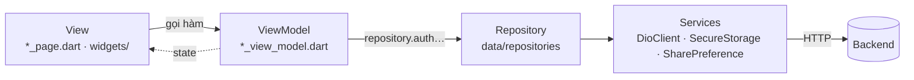
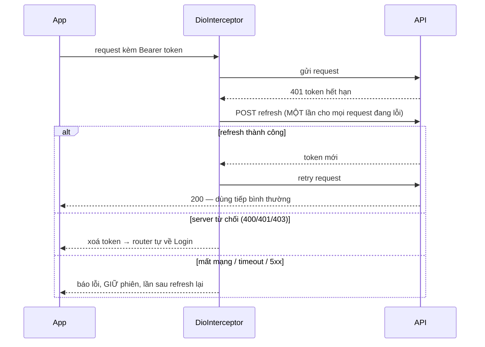
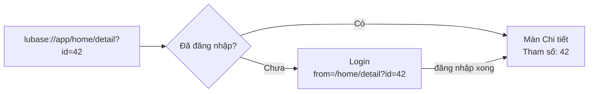

<h1 align="center">luBase (Bloc)</h1>

<p align="center">
  Base Flutter <b>MVVM + Bloc + get_it</b> để khởi tạo app mới thật nhanh — đã có sẵn đăng nhập, refresh token,<br>
  deep link, 3 môi trường, đa ngôn ngữ, test và CI. Clone về, đổi tên, viết feature. ✨
</p>

<p align="center">
  
  
  
  
  <a href="https://github.com/lluciper/lubase/actions/workflows/ci.yml"></a>
</p>

---

## Mục lục

1. [Base có gì?](#-base-có-gì)
2. [Công nghệ](#-công-nghệ)
3. [Chuẩn bị máy](#-chuẩn-bị-máy)
4. [Bắt đầu một project mới từ base](#-bắt-đầu-một-project-mới-từ-base)
5. [Chạy và build](#-chạy-và-build)
6. [Kiến trúc](#-kiến-trúc)
7. [Các thành phần của base](#-các-thành-phần-của-base)
8. [Thêm một feature](#-thêm-một-feature)
9. [Test và CI](#-test-và-ci)
10. [Làm việc cùng Claude Code](#-làm-việc-cùng-claude-code)
11. [Giới hạn đã biết](#-giới-hạn-đã-biết)

---

## 🌸 Base có gì?

| | Tính năng | Ghi chú |
|---|---|---|
| 🏛️ | **MVVM + Bloc** | `BasePage` / `BaseViewModel` (Cubit), DI bằng `get_it`, quy tắc phụ thuộc giữa các tầng rõ ràng. Song sinh với base Riverpod: chỉ khác phần state |
| 🔐 | **Đăng nhập & token** | Lưu token an toàn, refresh **một lần dùng chung** khi nhiều request cùng 401, retry tự động, chỉ đăng xuất khi server thật sự từ chối |
| 🔗 | **Deep link** | `lubase://app/<màn>`; chưa đăng nhập thì qua Login rồi **đi tiếp đúng màn**; có param |
| 🧭 | **Điều hướng typed** | go_router + go_router_builder, guard đăng nhập, hết phiên tự về Login |
| 🌍 | **3 môi trường** | dev / stg / prod qua `dart_defines/*.json`, Android flavor cài song song, cấu hình VS Code sẵn |
| 🗣️ | **Đa ngôn ngữ** | Tiếng Anh + Tiếng Việt (ARB), đổi ngôn ngữ ngay trong app |
| 🌗 | **Sáng / tối** | Đổi theme ngay trong app, màu qua `context.colors` |
| 🚨 | **Xử lý lỗi** | Thông báo lỗi thân thiện (hiện `msg` của server), một chỗ gom lỗi để gắn Crashlytics/Sentry |
| ⏳ | **Loading** | Overlay tự tắt khi **mọi** request xong, không đụng ViewModel đã đóng sau khi page đóng |
| 🧪 | **Test + CI** | Hơn 100 test bảo vệ hành vi của base, GitHub Actions kiểm tra code sinh, format, analyze, test |
| 🤖 | **Skill cho Claude Code** | `/project-setup`, `/feature-team`, `/bugfix-team` — làm việc như một team BA → DEV → QA |

---

## 🧰 Công nghệ

| Mảng | Thư viện |
|---|---|
| SDK | Flutter 3.47 · Dart 3.13 |
| State | `flutter_bloc` 9 (`Cubit`) |
| DI | `get_it` 9 (container `getIt`, đăng ký trong `Dependence`) |
| Điều hướng | `go_router` 18 + `go_router_builder` 4.5 |
| Mạng | `dio` 5.11 + `retrofit` 4.10 |
| Model | `freezed` 4 (state, entity) · `json_serializable` 6 (DTO) |
| Lưu trữ | `flutter_secure_storage` 11 (token) · `shared_preferences` |
| Đa ngôn ngữ | `intl` + `intl_utils` (class `S`) |
| Asset | `flutter_gen` (class `Assets`) |
| Lint | `flutter_lints` |
| Android | Gradle 9.3.1 · AGP 9.1 · Kotlin 2.4 · Java 17 |
| iOS | Deployment target 15.0 · Swift Package Manager |

---

## 💻 Chuẩn bị máy

- **Flutter 3.47.x** (`flutter --version`).
- **Xcode** (build iOS) và **Android Studio** (có sẵn JDK 17+ và Android SDK).
- Chấp nhận license Android một lần: `flutter doctor --android-licenses`.
- **VS Code** + extension *Flutter* (để dùng các cấu hình chạy có sẵn).
- `make` (macOS có sẵn).

Kiểm tra nhanh: `flutter doctor` không còn mục đỏ nào ở Flutter / Android / Xcode.

---

## 🚀 Bắt đầu một project mới từ base

### Bước 1 — Tạo repo từ base

```bash
git clone git@github.com:lluciper/lubase.git my_app
cd my_app
rm -rf .git && git init          # bỏ lịch sử của base, bắt đầu lịch sử mới
```

> Hoặc bấm **Use this template** trên GitHub nếu repo được bật chế độ template.

### Bước 2 — Cài đặt và sinh code

```bash
make init        # flutter pub get + build_runner + l10n
make check       # dart analyze --fatal-infos + flutter test → phải xanh
```

### Bước 3 — Chạy thử base trước khi sửa gì

VS Code → **Run and Debug** → chọn **`dev iOS`** hoặc **`dev Android`** → ▶️

Ở môi trường **dev**, base **đăng nhập giả** (chưa có API thật): nhập **email hợp lệ bất kỳ + mật khẩu ≥ 8 ký tự**, ví dụ `test@example.com` / `12345678`.

### Bước 4 — Biến base thành app của bạn

**Cách nhanh (khuyến nghị):** mở project bằng Claude Code rồi chạy

```
/project-setup <mô tả dự án, PRD, tài liệu API, Figma, brand guideline…>
```

Skill sẽ hỏi lại những gì còn thiếu, ghi mục tiêu vào [`PROJECT.md`](PROJECT.md), cấu hình base và lập backlog feature.

**Cách tay** — làm lần lượt (danh sách đầy đủ, đúng từng file: [`setup-checklist.md`](.claude/skills/project-setup/setup-checklist.md)):

| # | Việc | Sửa ở đâu |
|---|---|---|
| 1 | **Tên app & bundle id** | Android: `android/app/build.gradle.kts` (`namespace`, `applicationId`, `resValue("string", "app_name", …)` từng flavor) và chuyển `MainActivity.kt` sang thư mục package mới · iOS: `PRODUCT_BUNDLE_IDENTIFIER`, `CFBundleDisplayName` · Web: `web/index.html`, `web/manifest.json` |
| 2 | **Scheme deep link** | `AndroidManifest.xml` (`android:scheme`), `Info.plist` (`CFBundleURLSchemes`), test `test/app_router_test.dart` và `test/platform_config_test.dart` |
| 3 | **Ký app iOS** | Xcode → Runner → *Signing & Capabilities* → chọn Team của bạn |
| 4 | **Base URL từng môi trường** | `lib/data/services/api_constants.dart` (`devBaseUrl`, `stagingBaseUrl`, `prodBaseUrl`) |
| 5 | **API đăng nhập** | `ApiConstants.login` / `refreshToken`, DTO trong `lib/data/models/auth/`, mã lỗi từ chối refresh trong `DioInterceptor._isRefreshRejected`, khoá `forceLogout`, khoá thông báo lỗi trong `ErrorHelper._serverMessage` |
| 6 | **Tắt đăng nhập giả** khi dev đã có API | `lib/core/dependence.dart` → `demoLogin: false`, xoá `DemoAuthRepository` |
| 7 | **Màu, font, icon** | `lib/resources/app_colors.dart`, `pubspec.yaml` (`fonts:`), `assets/` → `make gen` |
| 8 | **Ngôn ngữ** | `lib/resources/l10n/intl_*.arb` → `make l10n` |
| 9 | **Màn mẫu** | Login / Home / Detail: giữ làm mẫu hoặc thay bằng màn thật |
| 10 | **README / PROJECT.md** | Ghi lại mục tiêu, phạm vi dự án |

### Bước 5 — Kiểm tra rồi commit

```bash
make gen && make l10n
dart format lib test
make check
git add . && git commit -m "Init project from lubase"
```

Đẩy lên GitHub là CI chạy tự động. Nhớ commit cả `pubspec.lock`.

---

## 🏃 Chạy và build

### Môi trường

| Môi trường | Cấu hình VS Code | File define | Android flavor |
|---|---|---|---|
| **dev** | `dev iOS` · `dev Android` | `dart_defines/develop.json` | `dev` → `….dev`, tên "… Dev" |
| **stg** | `stg iOS` · `stg Android` | `dart_defines/stage.json` | `stage` → `….stg`, tên "… Stg" |
| **prod** | `prod iOS` · `prod Android` | `dart_defines/production.json` | `prod` → applicationId gốc |

- Android có flavor nên **cài song song được 3 bản**; iOS không có flavor.
- File `dart_defines` được commit → **không bao giờ để bí mật trong đó**.

### Dòng lệnh

```bash
# Android: bắt buộc --flavor
flutter run --flavor dev --dart-define-from-file=dart_defines/develop.json
# iOS / web
flutter run --dart-define-from-file=dart_defines/develop.json

# Build phát hành
flutter build appbundle --flavor prod --dart-define-from-file=dart_defines/production.json
flutter build ipa --dart-define-from-file=dart_defines/production.json
```

### Thử deep link

Định dạng: **`lubase://app/<đường dẫn>`**

| Link | Kết quả |
|---|---|
| `lubase://app/home` | Màn Home |
| `lubase://app/login` | Màn Login |
| `lubase://app/home/detail?id=42` | Màn Chi tiết — "Tham số: 42" |
| `lubase://app/home/detail?id=Xin%20ch%C3%A0o` | "Tham số: Xin chào" (mã hoá URL) |

```bash
# iOS Simulator
xcrun simctl openurl booted "lubase://app/home/detail?id=42"
# Android (chọn đúng bản: .dev / .stg / gốc)
adb shell 'am start -a android.intent.action.VIEW -c android.intent.category.BROWSABLE -d "lubase://app/home/detail?id=42"' com.example.lubase.dev
```

Máy thật: dán link vào Notes / Safari / Chrome rồi bấm.

---

## 🧱 Kiến trúc

### Luồng MVVM



- **View** chỉ hiển thị và gọi `viewModel.x()`; không gọi API, không validate.
- **ViewModel** giữ state (freezed), gọi repository; không biết `BuildContext`, không điều hướng, không mở dialog.
- **Repository** gom logic dữ liệu theo domain; **Services** là API client và storage.

### Cấu trúc thư mục

```
lib/
├── main.dart              # Bắt lỗi toàn cục, chọn môi trường, khởi tạo DI → runApp
├── app.dart               # MaterialApp.router: router, ngôn ngữ, theme
├── app_router.dart        # Toàn bộ route (typed), deep link, guard đăng nhập
├── core/                  # Hạ tầng base — KHÔNG biết feature nào
│   ├── base_page.dart     # BasePage / BasePageState + loading & xử lý lỗi (FutureEx)
│   ├── base_view_model.dart
│   ├── dependence.dart    # Composition root: Dio, storage, Repository
│   ├── app_flavor.dart · locale_support.dart · theme_support.dart · refresh_service.dart
│   └── widgets/           # BaseDialog, DialogPlatform, LoadingWrapper…
├── data/                  # M — Model
│   ├── models/<domain>/   # DTO theo domain (auth/…)
│   ├── repositories/      # <domain>_repository.dart + Repository gom tất cả
│   └── services/          # DioClient (retrofit), interceptor, SecureStorage…
├── view/                  # V + VM
│   ├── entities/          # Validate input form (email, password…)
│   └── features/<feature>/  # <feature>_page / _view_model / _state + widgets/
├── resources/             # Màu, ARB, file sinh (S, Assets)
└── utils/                 # Helper, extension
test/                      # Mirror lib/; fake dùng chung ở test/helpers/fakes.dart
dart_defines/              # Biến môi trường (ENV) cho dev / stg / prod
.vscode/launch.json        # Cấu hình chạy dev|stg|prod × iOS|Android
```

### Quy tắc phụ thuộc

```
view/ ──▶ core/ ──▶ data/ ──▶ utils/ ──▶ resources/
```

- Page/widget **không import `data/`** — chỉ ViewModel làm việc với dữ liệu.
- `core/` không biết feature; feature không import feature khác.
- `main.dart`, `app.dart`, `app_router.dart` là composition root, được import mọi thứ.

Chi tiết và lý do từng quy tắc: [`CLAUDE.md`](CLAUDE.md).

---

## 🧩 Các thành phần của base

### BasePage & BaseViewModel

```dart
class _LoginPageState extends BasePageState<LoginPage, LoginViewModel> {
  @override
  LoginViewModel createViewModel() => LoginViewModel(); // tạo một lần, base tự close()

  @override
  Widget buildBody(BuildContext context) => Text(
        viewModel.listen(context, (s) => s.email.value ?? ''), // chỉ rebuild khi field này đổi
      );

  void onPressLogin() => viewModel
      .onPressLogin()
      .subscribeLoadingFullScreen(this)                            // overlay tới khi xong
      .subscribeOnSuccess(this, success: (_) => const HomeRoute().go(context))
      .subscribeHandleError(this);                                 // dialog lỗi thân thiện
}
```

- Base giữ ViewModel sống suốt vòng đời page, `close()` khi page đóng, chặn mọi thao tác với ViewModel/`context` sau đó.
- Hook vòng đời: `onInitState`, `onStateCreated`, `onAppearedPage`, `onDisappearedPage`, `onRefreshPage`, `onDispose`.

### Đăng nhập, token và phiên



**Chỉ đăng xuất khi:** refresh bị server từ chối, không còn refresh token, server trả `forceLogout`, hoặc người dùng bấm Đăng xuất. Đã refresh thành công mà request vẫn 401 → chỉ báo lỗi, vẫn dùng tiếp.

Thêm: token lưu trong Keychain/Keystore (cache trong bộ nhớ), Android tắt backup, cài lại app trên iOS sẽ xoá token cũ, request upload `FormData` được retry đúng.

### Điều hướng & deep link



- Route khai báo typed trong `lib/app_router.dart` — thêm param chỉ cần thêm field rồi `make gen`.
- Màn cần đăng nhập: override `redirect` như `HomeRoute`; route con kế thừa guard của route cha.
- Mở app không qua link: có token → Home, chưa có → Login. Link không tồn tại → về màn đầu.

### Lỗi, log và báo cáo

| Tình huống | Người dùng thấy |
|---|---|
| Mất mạng | "Lỗi mạng…" |
| Timeout | "Yêu cầu đã hết thời gian chờ…" |
| 4xx có `msg` từ server | Đúng câu của server |
| 5xx | "Lỗi máy chủ…" |
| Lỗi khác (bug) | "Đã xảy ra lỗi…" + gửi về `reportError` |

- Không bao giờ hiện `toString()` cho người dùng.
- Log request/response chỉ ở bản debug, không in body đăng nhập/refresh (mật khẩu, token).
- Mọi lỗi không bắt được đi về `lib/utils/error_reporter.dart` — chỗ gắn Crashlytics/Sentry.

### Đa ngôn ngữ & theme

- Chuỗi trong `lib/resources/l10n/intl_en.arb` và `intl_vi.arb` → `make l10n` → dùng `S.current.xxx`.
- Đổi ngôn ngữ: `getIt<LocaleCubit>()`; đổi sáng/tối: `getIt<ThemeCubit>()`; màu: `context.colors.xxx`.

---

## ➕ Thêm một feature

**Cách nhanh:** `/feature-team <yêu cầu, ticket, API spec hoặc ảnh Figma>` — skill phân tích yêu cầu thành tiêu chí nghiệm thu, code, viết test, chạy test, review rồi cập nhật `PROJECT.md`.

**Cách tay:**

1. DTO trong `lib/data/models/<domain>/` → `make gen`
2. Endpoint trong `ApiConstants` + `DioClient`, logic trong `<domain>_repository.dart`
3. `view/features/<feature>/`: `_state.dart` (freezed), `_view_model.dart`, `_page.dart`
4. Route trong `lib/app_router.dart` → `make gen` (deep link chạy được luôn)
5. Chuỗi vào **cả** `intl_en.arb` và `intl_vi.arb` → `make l10n`
6. Test ViewModel + test page → `make check`

Gặp lỗi: `/bugfix-team <mô tả lỗi, log, ảnh chụp>` — tái hiện bằng test đỏ, tìm nguyên nhân gốc, sửa, thêm test chống tái phát.

---

## 🧪 Test và CI

```bash
make check     # dart analyze --fatal-infos + flutter test
```

| Phần | File test |
|---|---|
| BasePage, loading, dialog lỗi, đổi ngôn ngữ | `test/core/base_page_test.dart` |
| Interceptor: refresh dùng chung, retry, chính sách đăng xuất | `test/data/services/dio_interceptor_test.dart` |
| Router: deep link, guard, hết phiên | `test/app_router_test.dart` |
| App: router + ngôn ngữ + theme | `test/app_test.dart` |
| Cấu hình native & môi trường | `test/platform_config_test.dart` |
| Feature mẫu Login (ViewModel + page) | `test/view/features/login/` |

**CI** (`.github/workflows/ci.yml`, mỗi push/PR): sinh lại code + l10n → format → **fail nếu file sinh chưa commit** → `dart analyze --fatal-infos` → `flutter test`.

---

## 🤖 Làm việc cùng Claude Code

| File / lệnh | Dùng để |
|---|---|
| [`CLAUDE.md`](CLAUDE.md) | Luật kỹ thuật của base (Claude đọc tự động) |
| [`PROJECT.md`](PROJECT.md) | Mục tiêu, phạm vi, backlog, quy tắc nghiệp vụ của dự án |
| `/project-setup` | Khởi tạo dự án mới từ base |
| `/feature-team` | Làm feature: BA → DEV → QA → Review |
| `/bugfix-team` | Sửa lỗi: tái hiện → nguyên nhân gốc → sửa → regression |

Nguyên tắc chung: **thay đổi nhỏ nhất mà vẫn trọn vẹn** (theo [ponytail](https://github.com/dietrichgebert/ponytail)) — đọc trước, dùng lại cái có sẵn, không bao giờ cắt validate, xử lý lỗi, bảo mật, accessibility.

---

## 🚧 Giới hạn đã biết

- API mock của dev chưa có login → môi trường dev **đăng nhập giả**; stg/prod gọi API thật.
- Base URL của 3 môi trường đang là cùng một URL mock — cần điền URL thật.
- Bản release chưa gắn dịch vụ báo crash (chỉ ghi log thiết bị).
- Ngôn ngữ mặc định `en`, chưa theo máy và chưa lưu lựa chọn; header `Accept-Language` cố định `vi`.
- iOS chưa có flavor; 3 flavor Android dùng chung scheme deep link (cài song song sẽ hỏi chọn app).
- Chưa có https App Links / Universal Links.

Danh sách luôn được cập nhật trong [`CLAUDE.md`](CLAUDE.md#giới-hạn-đã-biết).

---

<p align="center"><i>Dori bug! 🎉</i></p>
